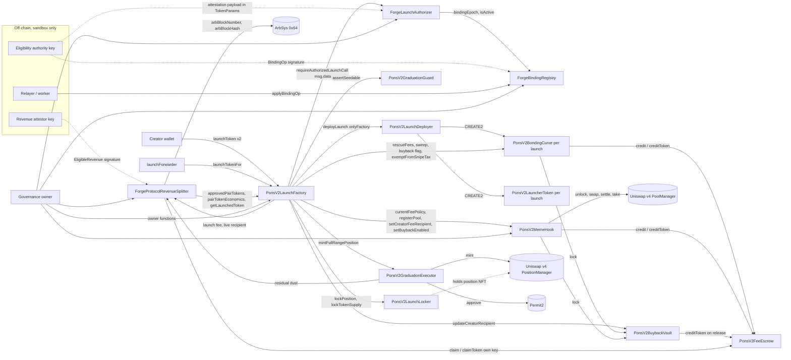

# 3. Contract dependency map and deployment topology

Derived from `contractsV2-forge/src` (call sites read in source), the factory's `_requireLaunchDependenciesWired`, `script/DeployForgeW02.s.sol` and the dry-run-only `apps/forge-web/scripts/w05/deploy-plan-lib.ts`. **No Forge contract is deployed anywhere**; addresses below exist only for the original PONS deployment (not Forge's) and are listed for orientation.

## 3.1 Contracts

| Contract | Kind | Deployed how | Owner model | Upgradeable |
| --- | --- | --- | --- | --- |
| `PonsV2LaunchFactory` | singleton | CREATE | `Ownable2Step`, `renounceOwnership` reverts | no |
| `ForgeLaunchAuthorizer` | singleton | CREATE | `Ownable2Step`, **renounce NOT disabled** | no |
| `ForgeBindingRegistry` | singleton | CREATE | `Ownable2Step`, **renounce NOT disabled** | no |
| `PonsV2MemeHook` | singleton (Uniswap v4 hook) | CREATE2 via the deterministic-deployment proxy, address low 14 bits must equal `0x2044` (`beforeInitialize \| afterSwap \| afterSwapReturnDelta`) | `Ownable2Step`, renounce reverts | no |
| `PonsV2FeeEscrow` | singleton | CREATE | none (no owner, no admin) | no |
| `PonsV2BuybackVault` | singleton | CREATE | `Ownable2Step`, renounce reverts | no |
| `PonsV2LaunchLocker` | singleton | CREATE | `Ownable2Step`, renounce reverts | no |
| `PonsV2LaunchDeployer` | singleton | CREATE | none; every entry is `onlyFactory` | no |
| `PonsV2GraduationExecutor` | singleton | CREATE | none; `mintFullRangePosition` is `onlyFactory` | no |
| `PonsV2GraduationGuard` | stateless helper | `new` inside the factory constructor | none | no |
| `ForgeProtocolRevenueSplitter` | singleton (Forge) | CREATE | `Ownable2Step`, `renounceOwnership` reverts | no |
| `PonsV2BondingCurve` | **per launch** | CREATE2 by the deployer | none; `onlyFactory` admin surface | no |
| `PonsV2LauncherToken` | **per launch** | CREATE2 by the deployer | none; fixed supply, no privileges | no |
| `PonsV2LaunchAndBuy` | optional periphery | not in any deploy plan | `Ownable2Step` | no |

Upgradeability: `docs/W05-AUTHORITY-MATRIX.md` asserts `upgradeable: false` for all ten contracts it lists. Independently (RAN: `grep -rn 'delegatecall\|selfdestruct\|functionDelegateCall' contractsV2-forge/src`): the only hit is a comment in `PonsV2BondingCurve.sol` about forced ETH. No proxy, `delegatecall` or `selfdestruct` exists in the Forge tree's own sources. Vendored libraries were not grepped exhaustively (NOT VERIFIED); the vendored OpenZeppelin `Multicall.sol` is present but nothing in `contractsV2-forge/src` or `contractsV2-deployed/src` references it.

## 3.2 Who calls whom

Solid arrows are on-chain calls found in source; dashed arrows are off-chain signatures that are verified on chain. The hook also accepts the splitter as its `protocolFeeRecipient` (an escrow key, not a call).

### Call-level notes (SOURCE)

- **Launch path.** `launchToken` (2 overloads) and `launchTokenFor` -> private `_launchToken`: `launchDeployer` set and `_requireLaunchDependenciesWired` -> `canLaunch(originalDeployer)` -> `msg.value == launchFee` -> config/pair/tax validation -> `memeHook.currentFeePolicy()` snapshot -> economics digest pin -> **`launchAuthorizer.requireAuthorizedLaunchCall(msg.data, originalDeployer, economics)`** -> `launchDeployer.deployLaunch` -> record -> `_payLaunchFee()` (to the hook's **live** `protocolFeeRecipient`, a direct call, no escrow).
- **Fee flow before graduation.** `PonsV2BondingCurve._sweepFees`: buyback slice -> `buybackVault.lock`; then `_creditQuote(protocolFeeRecipient, protocolAmount)` **first**, then `_creditQuote(deployer, creatorAmount)` -> `feeEscrow.credit/creditToken`. The ledger attributes legs by this order (DOC: `docs/W04-ECONOMICS-ARCHITECTURE.md` section 3; order confirmed in source).
- **Fee flow after graduation.** `PonsV2MemeHook.sweepPoolFees` -> `_distribute`: `_payOut(creator...)` **first**, then `_payOut(protocolFeeRecipient...)` -> `feeEscrow.credit/creditToken`; buyback -> `buybackVault.lock`.
- **Graduation.** `graduate(token)` (permissionless) -> `_sweepCurve` (reserves into the factory, phase `Swept`) -> `createGraduatedPool(token)` (permissionless): `graduationGuard.assertSeedable` -> `memeHook.registerPool` -> `graduationExecutor.mintFullRangePosition` (Permit2 + PositionManager mint; residual dust to the snapshot `protocolFeeRecipient`) -> `locker.lockPosition`. Excess tokens above the terminal-price requirement go to `locker.lockTokenSupply`. A seed that cannot succeed is handled by owner `forceSweptGraduation` / `rescueSweptGraduation` (F-04).
- **Claims.** `PonsV2FeeEscrow.claim*` pay `msg.sender` only. The splitter is an escrow *recipient key*: it claims only its own balance and allocates the measured receipt.

## 3.3 Constructor and one-time wiring (SOURCE: `deploy-plan-lib.ts`, `DeployForgeW02.s.sol`)

Dependency-ordered. Roles in the plan: `deployer`, `governance`, `treasury`, `eligibilityAuthority`, `revenueAttestor`, `feeSweepOperator` (pairwise distinct is enforced by the plan; the sandbox uses single Anvil keys).

| # | Step | Constructor / call | Notes |
| --- | --- | --- | --- |
| 1 | `PonsV2FeeEscrow` | `()` | canonical, ownerless |
| 2 | `ForgeProtocolRevenueSplitter` | `(feeEscrow, owner=deployer, treasuryRecipient, revenueAttestor)` | attestor must differ from treasury, owner and the splitter |
| 3 | `PonsV2MemeHook` | `(poolManager, feeEscrow, protocolFeeRecipient = splitter, initialOwner = deployer)` via CREATE2 to mask `0x2044` | defaults set in the constructor: `protocolFeeShareBps = 3000`, `buybackBurnBps = 5000`, `hookFeeBps = 100`, `maxInternalPriceImpactBps = 300`, `feeSweepOperator = initialOwner`. Naming the splitter as the recipient **before any launch** is what makes new launches' snapshots eligible |
| 4 | `PonsV2BuybackVault` | `(initialOwner, feePolicy = hook, feeEscrow)` | |
| 5 | `PonsV2LaunchLocker` | `(initialOwner, positionManager)` | |
| 6 | `ForgeBindingRegistry` | `(authority)` | EIP-712 name `FINCO Forge Binding Registry`, version `2` |
| 7 | `ForgeLaunchAuthorizer` | `(registry, eligibilityAuthority)` | EIP-712 name `FINCO Forge Launch`, version `1` |
| 8 | `PonsV2LaunchFactory` | `(initialOwner, poolManager, positionManager, permit2, locker, memeHook, feeEscrow, buybackVault, launchAuthorizer, initialLaunchFee)` | requires `positionManager.poolManager() == poolManager` at construction; creates `PonsV2GraduationGuard` |
| 9 | `PonsV2LaunchDeployer` | `(factory)` | |
| 10 | `PonsV2GraduationExecutor` | `(positionManager, permit2, locker, factory)` | |
| 11 | wiring (all one-time, `onlyOwner`) | `authorizer.setForgeFactory`, `hook.setFactory`, `hook.setBuybackVault`, `vault.setFactory`, `locker.setFactory`, `factory.setLaunchDeployer`, `factory.setGraduationExecutor`, `splitter.setForgeFactory`, `hook.setFeeSweepOperator`, `factory.addLaunchConfig` | the factory refuses launches until `_requireLaunchDependenciesWired` passes |
| 12 | hand-over | per owned contract: `transferOwnership(governance)` by deployer, `acceptOwnership()` by governance | seven contracts: registry, authorizer, factory, hook, vault, locker, splitter |
| 13 | go-live | `factory.setLaunchEnabled(true)` by governance | `requiresSignOff`; **disabled** (`DEPLOY_WRITE_ENABLED=false`, chain 4663 refused) |

Post-deploy invariants the plan asserts (`expectedRoles`/`treasuryChecks`): hook `protocolFeeRecipient == splitter`, hook `protocolFeeShareBps == 3000`, splitter `FINCO_BURN_ENABLED == false`, `pullsPaused == false`, `RECIPIENT_TIMELOCK == 259200`, runtime code equals artifact with immutables masked.

## 3.4 Immutable cross-references (where wiring cannot be repaired)

- Factory immutables: `poolManager`, `positionManager`, `permit2`, `locker`, `memeHook`, `feeEscrow`, `buybackVault`, `launchAuthorizer`, `graduationGuard`. A wrong value means a new factory.
- Authorizer: `registry` immutable; `forgeFactory` set exactly once (`FactoryAlreadySet`). Authority key is mutable by the authorizer owner.
- Registry: `eligibilityAuthority` mutable by its own owner; rotation must be done on **both** contracts in one governance batch (risk W02-R1).
- Splitter: `feeEscrow` immutable; `forgeFactory` set once; treasury recipient and attestor timelocked.
- Per launch: the curve freezes `protocolFeeRecipient`, `protocolFeeShareBps`, `buybackBurnBps`, `maxInternalPriceImpactBps`, fee bps and the buyback creator recipient as immutables; the hook freezes the same snapshot at `registerPool`.

## 3.5 Reference only: the original PONS deployment (not Forge's)

`provenance/*/evidence.json` records the live addresses on chain 4663 (table in `PROVENANCE-AND-LICENSING.md` 2.3). Forge's design treats that deployment as outside Forge authority (`docs/W04-FEE-AUTHORITY.md` flow 17); the Forge stack is a separate set of fresh deployments that does not exist yet.
